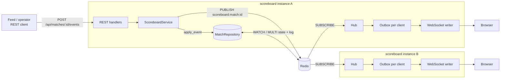

# live-scoreboard-tornado

**A real-time football scoreboard: match events go in over REST, derived scores fan out to browsers over Tornado WebSockets, with Redis pub/sub linking server instances.**

[](https://github.com/alexgeorghiou/live-scoreboard-tornado/actions/workflows/ci.yml)
[](LICENSE)


## Features

- **Event feed with derived state.** Goals (including penalties and own goals), disallowed goals, yellow and red cards (a second yellow becomes a red), substitutions and period changes. A pure reducer turns them into the score, timeline and match status, and rejects anything the rules don't allow: goals at half-time, a substitute coming back on, extra time when one side is ahead, and so on.
- **Per-match subscriptions.** Clients subscribe to the matches they care about. Each process holds exactly one broker subscription per watched match, however many sockets are watching it.
- **Redis pub/sub fan-out** behind a small `Broker` interface. An `InMemoryBroker` covers tests and single-node development. The Redis implementation reference-counts channels and re-subscribes after a reconnect.
- **Heartbeats.** The server sends protocol pings, the client sends application pings, and an idle timeout closes half-open connections on both sides.
- **Backpressure.** Every client gets a bounded outbox. When a slow consumer fills it, the server either disconnects that client or conflates its queue (a newer update for the same match replaces the older one). Updates that had to be dropped trigger a catch-up snapshot, and a client that never catches up gets disconnected anyway.
- **REST API for feeds.** Idempotent event ids, optimistic concurrency via `If-Match`, authoritative snapshots for resync, and optional bearer-token auth.
- **Vanilla ES module frontend.** No build step. It reconnects with jittered backoff, uses versions to drop stale updates and spot gaps, and includes a small feed console.
- **Demo simulator** that plays seeded random matches against the API.

## Architecture



An accepted event moves through these steps:

1. `parse_event` validates the payload's structure.
2. The repository loads the current state, runs the reducer and atomically stores both the new state and the event. It uses `WATCH`/`MULTI` on Redis and runs inline in memory.
3. The service publishes `{type: "event", version, event, state}` to the match channel.
4. On every instance that has watchers for the match, the hub parses the message once and offers it to each client's outbox. Offering never blocks.
5. Each connection's writer task drains its own outbox, so a slow socket only ever holds up its own writer.

## Quickstart

### Local (in-memory backend)

```bash
python -m venv .venv
source .venv/bin/activate        # Windows: .venv\Scripts\activate
pip install -e ".[dev]"
DEBUG=1 scoreboard               # http://localhost:8888
# in another terminal
scoreboard-sim --matches 3 --tick 0.5
```

### Docker Compose (Redis + two instances)

```bash
docker compose up --build
docker compose --profile demo up simulator   # feed three demo matches
```

Open <http://localhost:8888> and <http://localhost:8889> side by side. The simulator posts every event to instance A, and both pages update live.

### Posting events by hand

```bash
curl -X POST localhost:8888/api/matches \
  -d '{"id":"derby","home_team":"Rovers","away_team":"United"}'
curl -X POST localhost:8888/api/matches/derby/events \
  -d '{"type":"period_change","period":"first_half"}'
curl -X POST localhost:8888/api/matches/derby/events \
  -d '{"id":"feed-1","type":"goal","team":"home","player":"Silva","minute":12}'
```

## API

| Method | Path | Notes |
| --- | --- | --- |
| `GET` | `/api/matches` | Summaries, including local watcher counts |
| `POST` | `/api/matches` | `{id?, home_team, away_team, competition?}` returns `201` |
| `GET` | `/api/matches/{id}` | Current state; `ETag` is the version |
| `GET` | `/api/matches/{id}/events?since=n` | Event log since the last snapshot |
| `POST` | `/api/matches/{id}/events` | `201` accepted, `200` duplicate id, `409` illegal, `412` on an `If-Match` mismatch |
| `PUT` | `/api/matches/{id}/snapshot` | Merge an authoritative state, reset the log and push it to clients |
| `GET` | `/healthz` | `503` if Redis is unreachable |
| `GET` | `/api/stats` | Connections, deliveries, evictions, drops and conflations |

For goals, `team` is the side that is credited. For an own goal, the scorer plays for the other side.

### WebSocket protocol (`/ws`, optional `?match=a,b`)

| Direction | Message |
| --- | --- |
| client to server | `{"op":"subscribe","match_id":"derby"}`, `unsubscribe`, `resync`, `{"op":"ping","ts":...}` |
| server to client | `hello` (heartbeat settings), `snapshot`, `event`, `unsubscribed`, `pong`, `error` |

Close codes: `4000` idle timeout, `4001` slow consumer, `4002` write timeout.

## Configuration

| Variable | Default | Meaning |
| --- | --- | --- |
| `PORT` / `HOST` | `8888` / `0.0.0.0` | Listen address |
| `REDIS_URL` | *(empty)* | Empty uses the in-memory broker and repository |
| `API_TOKEN` | *(empty)* | Bearer token required for write endpoints |
| `PING_INTERVAL` / `IDLE_TIMEOUT` | `15` / `45` s | Heartbeat cadence and dead-peer cutoff |
| `WRITE_TIMEOUT` | `10` s | Longest a single frame write may take |
| `OUTBOX_SIZE` | `64` | Per-client queue bound |
| `OVERFLOW_POLICY` | `drop_oldest` | `drop_oldest` or `disconnect` |
| `MAX_DROPS` | `256` | Drops allowed without a successful write before disconnecting |
| `MAX_SUBSCRIPTIONS` | `20` | Matches per connection |
| `ALLOWED_ORIGINS` | *(same host)* | Comma-separated list, or `*` |

## Project structure

```
scoreboard/
  domain/events.py      event model + structural validation
  domain/state.py       MatchState and the pure reducer (rules of the game)
  repository/           event log + derived state: in-memory and Redis (WATCH/MULTI)
  broker/               Broker interface, InMemoryBroker, RedisBroker
  service.py            validate -> persist -> publish
  hub.py                one broker subscription per match, local fan-out
  backpressure.py       bounded Outbox with conflation and overflow policies
  heartbeat.py          ping schedule and idle-timeout policy (injectable clock)
  web/socket.py         WebSocket handler: writer and heartbeat tasks per connection
  web/api.py            REST handlers and error mapping
  simulator.py          demo feed
static/                 index.html, style.css, js/{app,socket,board}.js
tests/                  unit tests + tornado.testing integration tests
```

## Testing

```bash
pytest                                   # unit + integration, uses fakeredis
REDIS_URL=redis://localhost:6379/0 pytest  # also runs real-Redis smoke tests
```

- Domain, backpressure and heartbeat logic are tested as plain unit tests. None of them sleep.
- One repository contract suite runs against both the in-memory and the Redis backend (the Redis one through `fakeredis`).
- `AsyncHTTPTestCase` + `gen_test` integration tests cover the REST API, subscriptions, heartbeats and idle eviction, both overflow policies under a publish burst, and two server instances sharing one Redis.
- CI runs ruff, the test matrix against a real Redis service container, and a Docker build with a health smoke test.

## Design decisions and trade-offs

- **Full state in every update.** Each message is a few hundred bytes larger than a bare delta, but any single message is enough to render the board. That makes it safe to drop or conflate messages for slow clients, and recovery is just "the next message".
- **Versions instead of acknowledgements.** The repository assigns each match a monotonically increasing `version`. The outbox skips anything older than what it already queued, and clients ignore stale updates and ask for `resync` when they see a gap. No per-client delivery state lives on the server.
- **Reducer in Python, optimistic locking in Redis.** A Lua script would make appends a single round trip, but it would also mean writing the rules of the game twice. `WATCH`/`MULTI` with retries keeps one implementation. Contention per match is low, since one feed usually writes each match.
- **Subscribe before reading the snapshot.** The hub registers the broker subscription first and reads the state afterwards. An event that lands in between therefore shows up either in the snapshot or after it, and versions remove the duplicate.
- **Pub/sub is fire-and-forget.** Redis pub/sub doesn't buffer for disconnected subscribers. A reconnecting instance gets fresh state from the repository rather than replaying missed messages. Redis Streams would allow replay, at the cost of trimming and consumer bookkeeping.
- **One writer task per socket.** Tornado's `write_message` future resolves once the frame has been flushed. Awaiting it inside a dedicated task turns kernel-buffer pressure into queue growth that we can observe and bound, rather than unbounded memory inside the IOStream.

## Roadmap

- Penalty shoot-out tracking as its own sub-state.
- Redis Streams option for replayable fan-out.
- Prometheus metrics endpoint alongside `/api/stats`.
- Per-feed API keys with scopes per match.
- Load-test script (many idle sockets plus a burst publisher) to tune outbox defaults.

## License

[MIT](LICENSE) © 2026 Alex Georghiou
